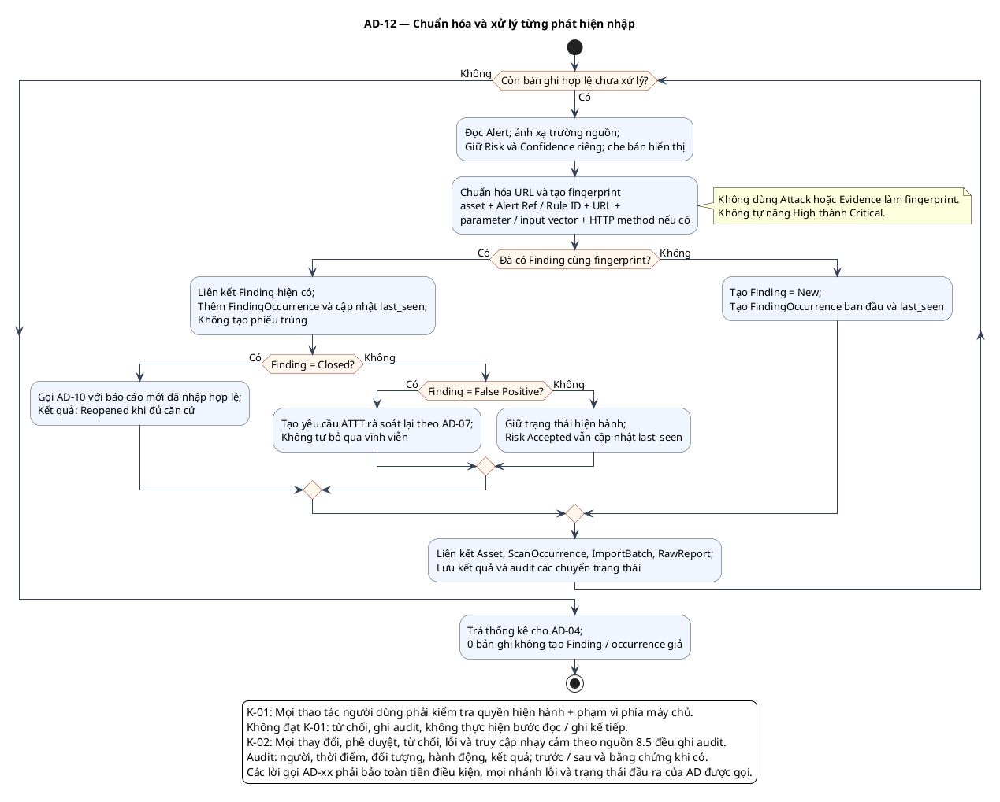

# AD-12 — Chuẩn hóa và xử lý từng phát hiện nhập

**Nguồn:** mục 5.3.4–5.3.5; 7.3–7.4 của tài liệu nguồn.

**Điều kiện vào:** Chỉ các bản ghi đã qua kiểm tra của lô không trùng từ AD-04.

**Kết quả:** Finding/occurrence được truy vết; số liệu xử lý trả AD-04, lỗi kỹ thuật trả nhánh Failed.

**Truy vết UC:** UC-I08, UC-I09, UC-I10.

**Quy ước xử lý:** Lỗi kỹ thuật dừng xử lý và trả Failed cho AD-04. Finding/occurrence đã ghi phải giữ truy vết, không được nhân đôi khi đọc lại kết quả cùng lô. AD-10 tại đây chỉ xét Closed và bản ghi hợp lệ đã ghi nhận, không xét việc cả lô là bằng chứng xác minh đủ điều kiện đóng.

