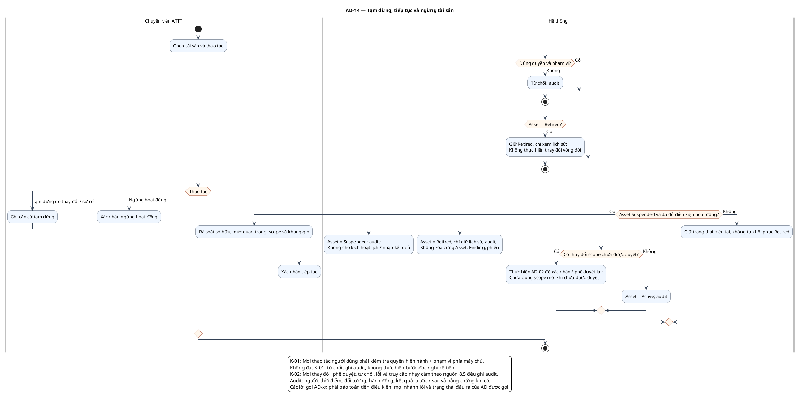

# AD-14 — Tạm dừng, tiếp tục và ngừng tài sản

**Nguồn:** mục 5.1.2–5.1.3; 8.5–8.6 của tài liệu nguồn.

**Điều kiện vào:** ATTT có quyền trên tài sản; không định nghĩa thêm trạng thái.

**Kết quả:** Suspended/Retired hoặc Active sau kiểm tra lại; lịch sử được bảo toàn.

**Truy vết UC:** UC-A02, UC-A05, UC-A06.

**Giới hạn trạng thái:** Tiếp tục từ Suspended là cách biểu diễn ý nghĩa tạm dừng; phải kiểm tra lại điều kiện nguồn. Không suy diễn chuỗi chuyển bắt buộc hay khôi phục Retired. Những cạnh vòng đời chưa được nguồn xác định không được cấp quyền chuyển tùy ý.

