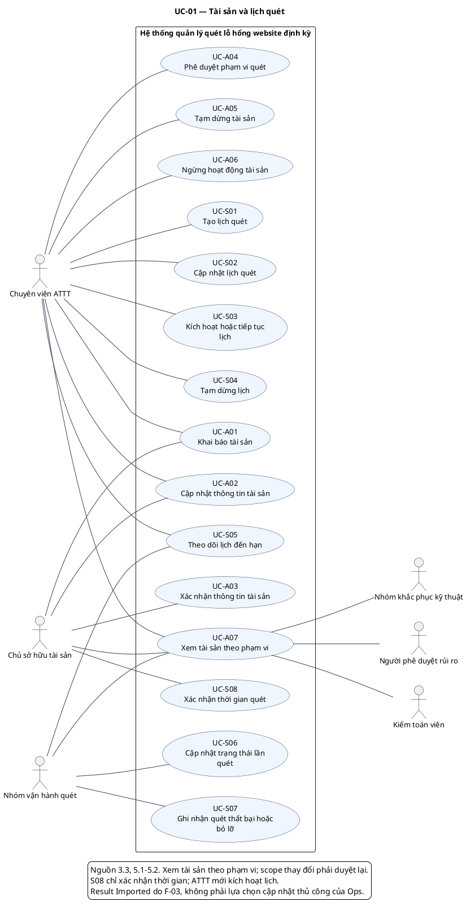

# UC-01 — Tài sản và lịch quét

Các mã UC và quyền được định nghĩa thống nhất trong tài liệu đặc tả. Association là tham gia; quyền quyết định theo vai trò và phạm vi, không suy ra từ chiều mũi tên.

